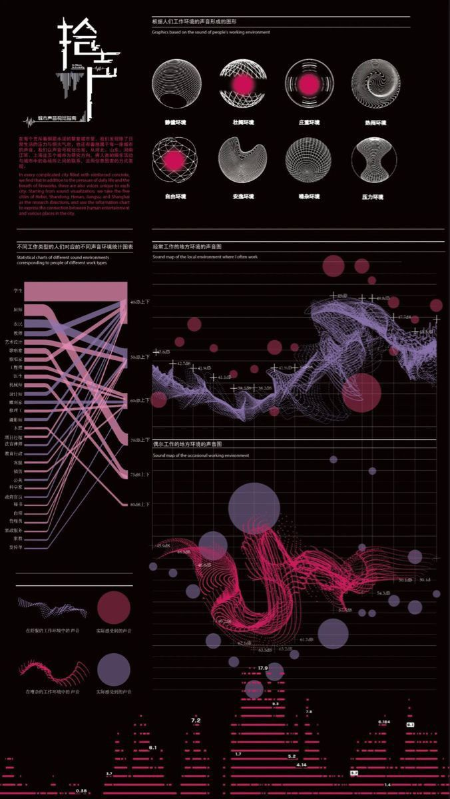

# 混合型信息图形（Mixed Charts）

## 归档说明
- **资料来源**：用户提供的“基于人们工作环境中的声音而成的信息图形”案例图。
- **归档类型**：混合型信息图形（Mixed Charts）。
- **主题**：工作环境声音 / 声景（Soundscape）可视化。
- **分析依据**：以下内容依据案例图中可见的标题、版面模块、图形形态与标签进行分析。原始数据表、采样说明和完整图例未在图片中充分呈现；无法确认的字段、单位和计算口径均标记为待核实，不将视觉推断当作原始事实。
- **图片文件**：`efe04803d31c6c18ade8b80672d1f5cb.png`（与本说明文档同目录）。

## 案例 01：工作环境声音声景可视化

### 图片内容概述
画面以黑色为背景，使用玫红、紫色和白色构建统一的视觉体系。顶部以八种球形网格/几何形态展示不同声音形态；左侧由文字说明和多条不同粗细的彩色流线组成类别关联图；中部上下排列两组大型网格波形/曲面图，并叠加不同大小的圆形气泡与标注；底部使用多组水平条形图和数值标签补充定量比较。

案例把工作环境中的声音转化为可观察的几何形态，结合分类关系、声景形态与数值图表，形成综合表达。

### 分类判断
- **主要表现类型**：混合型信息图形（Mixed Charts）。
- **辅助表现特征**：比较型表达、抽象声学形态可视化。
- **底层数据逻辑**：分类、关联和多维比较；具有分组对照结构。
- **判断依据**：页面组合了流向关系图、气泡/散点式标记、网格曲面/波形、条形图和几何符号图。不同图形共同解释同一主题，且使用颜色、形态、空间布局进行视觉叙事，不是将单一统计图重复排版。
- **不归入编年型的原因**：画面没有以连续时间顺序或不可逆事件序列组织主要阅读路径。

### A. 基本的数据逻辑（Data Logic）
本案例的核心逻辑是**声音类别组织 + 类别关联 + 不同声景之间的比较**，并非单纯时间序列。

1. **分类逻辑**：顶部的几何声形、左侧类别标签以及中部不同声景模块，显示案例先对工作环境声音或声音表现进行分组。
2. **关联逻辑**：左侧多条流线将不同类别/对象连接起来，表达类别之间的对应或关联。若流线宽度映射数量，则可进一步表达流量或权重；但具体映射须由原始图例确认。
3. **比较逻辑**：中部上下两组声景图形并置，形成两种工作环境/声音情境的对照。
4. **多维逻辑**：气泡、曲面、线条和底部条形图可能承载不同声学或分类指标，构成多变量、多视角表达。

可概括为：
**工作环境/声音类别 → 类别关系 → 声音形态与特征 → 情境比较 → 数值补充。**

**数据逻辑边界**：图中可见若干数值和声学标注，但原图未充分展示完整字段定义、单位、采样方法和图例。因此不能仅凭图像断言气泡面积一定代表音量、网格高度一定代表分贝，或流线宽度一定代表样本量；这些映射应以原始数据说明为准。

### B. 使用了怎样的统计图形与计算方式（Statistical Graphics）
本案例通过多种图形语法共同表达声音数据：

1. **流向关系图 / 桑基式流线（Flow / Sankey-like Diagram）**
   - 位置：画面左侧。
   - 作用：用曲线连接不同类别标签，呈现类别之间的联系或流向。
   - 统计基础：若流线宽度代表数量，可依据类别间的频数、流量或权重设置宽度；若无定量宽度图例，则应视为关系示意，不宜读取精确数值。

2. **气泡图 / 气泡散点式标记（Bubble / Bubble Scatter）**
   - 位置：中部两组声景曲面周围。
   - 作用：以圆形位置、大小和颜色增加多变量表达。
   - 统计基础：位置可对应两个变量，圆面积可映射第三变量；若用面积编码数值，应按面积而不是半径线性缩放。案例图未完整说明各视觉通道对应的具体字段。

3. **网格曲面与波形图（Mesh Surface / Waveform）**
   - 位置：中部上下两组大型声景图形。
   - 作用：以连续曲线、网格密度和起伏形态呈现声音的抽象特征。
   - 统计基础：可用于表达连续信号、频率/振幅或其他声学变量，但本案例具体坐标轴及变量含义仍需原始图例确认。不能把艺术化曲面直接等同于标准声谱图。

4. **水平条形图（Horizontal Bar Chart）**
   - 位置：画面底部。
   - 作用：比较不同项目或类别的数值大小。
   - 统计基础：条长对应数值；若比较比例，应明确分母和百分比口径。图中可见数值标注，但字段名称与单位部分较小，需核对原始高清图或数据表。

5. **几何符号/网格球体（Geometric Symbol Encoding）**
   - 位置：顶部。
   - 作用：以不同球形网格和几何结构呈现声音形态或类型概念。
   - 统计基础：主要属于分类性、解释性视觉编码，不应在没有图例时视为定量统计图。

**统计图形总结**：流向关系图负责关系表达，气泡图负责多变量标记，网格曲面/波形负责连续形态呈现，条形图负责数值比较，几何球体负责类别或概念识别。它们共同构成混合型信息图形。

### C. 视觉编码（Visual Encoding）
| 视觉元素 | 本案例中的使用方式 | 信息作用 |
|---|---|---|
| 点 | 玫红/紫色圆形气泡、离散标记 | 表示独立数据点或重点节点；大小可能承载附加变量 |
| 线 | 流向曲线、波形线、网格线、辅助网格 | 表现类别关联、连续变化和空间结构 |
| 面 | 网格曲面、波形包络、图表分区 | 将声音变化组织成连续视觉区域 |
| 体/空间 | 球形网格、立体感曲面 | 将抽象声学概念转化为具有空间感的形态 |
| 符号 | 顶部几何球体、圆形气泡、类别标记 | 形成声音类别或视觉概念的识别系统 |
| 色彩 | 黑色底色、玫红、紫色、白色 | 黑色压低背景干扰；玫红与紫色区分不同数据组/情境；白色承担标题、网格和注释 |
| 文字 | 标题、分类标签、数值、坐标/注释 | 说明类别、单位和阅读线索 |

**视觉优化方法：**
- 以黑色作为统一底色，强化发光感线条和圆形标记的对比。
- 使用玫红与紫色建立两组主要视觉色彩，帮助区分不同声景模块。
- 通过线条密度、方向和起伏构建声音的动态感。
- 将抽象曲面与常规条形图并置，使感性形态和可比较数值互相补充。
- 以分区标题、横向分隔线和网格建立版面秩序，避免抽象图形完全失去阅读锚点。

**编码规范建议**：正式复用该设计方法时，应在图例中明确颜色、气泡面积、线宽、曲面高度、坐标轴和单位分别代表什么。没有数据依据的装饰形态应与定量编码区分。

### D. 数据/信息架构（Information Architecture）
整张图采用**纵向模块分区 + 中部上下对照 + 左侧关系索引**的架构。

| 版面区域 | 可见内容 | 信息作用 |
|---|---|---|
| 顶部 | 主题标题、说明文字、八种球形几何形态 | 引入声音主题，并提供类别/形态的视觉索引 |
| 左上 | 主题介绍与背景说明 | 交代研究对象和阅读背景 |
| 左中 | 类别标签与多条流线 | 展示不同类别之间的对应或关联 |
| 左下 | 声音形态示例与色彩圆点图例 | 提供形态和颜色的辅助解释 |
| 中部上方 | 第一组网格声景曲面、气泡和标注 | 展示一种工作情境的声音形态 |
| 中部下方 | 第二组网格声景曲面、气泡和标注 | 展示另一种工作情境，形成对照 |
| 底部 | 多组条形图与数值标签 | 补充类别间的定量比较 |

信息层级可概括为：
**主题引入 → 声音形态分类 → 类别关联 → 两种声景对照 → 数值统计补充。**

### E. 视觉叙事架构（Visual Narrative）
本案例以空间分区和上下对照构建叙事，而不是依赖时间轴：

1. **建立主题**：顶部标题和几何球形图案提出“工作环境声音”的主题。
2. **认识类别**：通过顶部形态符号与左侧标签，建立声音类型的分类入口。
3. **理解关联**：左侧流线将类别联系起来，提示不同声音类别之间存在关系。
4. **观察声景**：中部两组大型网格曲面把声音特征转化为抽象形态。
5. **比较情境**：上下声景模块形成对照，配合气泡与标注呈现差异。
6. **查看数值**：底部条形图提供更直接的数值比较，为抽象视觉形态补充定量信息。

可概括为：
**主题认知 → 类别识别 → 关系理解 → 声景呈现 → 情境比较 → 数值验证。**

### 与相近类型的辨析
| 类型 | 本案例中的关系 | 判断依据 |
|---|---|---|
| 混合型信息图形 | 主要类型 | 多种统计图形、抽象符号和声景形态共同表达一个主题 |
| 比较型信息图形 | 辅助特征 | 中部上下两组声景并置，形成情境对照 |
| 单一图表型 | 不作为主要分类 | 页面不是围绕一种统计图表展开 |
| 编年型 | 不属于 | 时间顺序不是主要组织依据 |
| 层级型/编目型 | 底层逻辑可能涉及 | 声音类别与标签具有分类组织，但不是唯一主线 |

### 案例登记
| 案例名称 | 来源 | 数据结构 | 统计/图解方法 | 视觉编码 | 叙事路线 | 待验证点 |
|---|---|---|---|---|---|---|
| 工作环境声音声景可视化 | 用户提供图片 | 分类、关联、多维比较、分组对照 | 流向关系图、气泡/散点式标记、网格曲面/波形、水平条形图、几何符号图 | 黑底、玫红/紫色、网格线、流线、气泡、球形结构 | 主题→分类→关联→声景展示→情境比较→数值补充 | 原始数据、声音类别定义、坐标轴、单位、气泡/线宽映射、采样与计算口径 |

## 相关的数据逻辑文档
[编年型](../../01-信息图形数据逻辑/01-编年型信息图形概念定义.md) · [层级型](../../01-信息图形数据逻辑/02-层级型信息图形概念定义.md) · [编目型](../../01-信息图形数据逻辑/03-编目型信息图形概念定义.md) · [字母表型](../../01-信息图形数据逻辑/04-字母表型信息图形概念定义.md) · [地理图形型](../../01-信息图形数据逻辑/05-地理图形信息图形概念定义.md)

---

## 案例 02：大数据时代下的信息泄露研究

**图片文件状态**：本次聊天已提供原图；GitHub 目录当前尚未确认存在该图的二进制文件，因此本节暂不添加会失效的 Markdown 图片链接。待原图上传后，建议命名为 `案例02-大数据时代下的信息泄露研究.png`，与本说明文档放在同一目录。

### 图片内容概述
该案例以黑色为底色，使用白色、灰色、金色和少量暖色点缀，主题为“大数据时代下信息泄露研究”。画面中心以环形、放射状的节点群呈现信息泄露的核心主题，并围绕中心标注基本信息、隐私信息、社会关系信息、网络行为信息、设备信息和账户信息等类别。左侧包含类别列表、连接线与点阵区域；右侧展示信息泄露途径分类；下方以散点/气泡分布、横向条形及其他小型统计图补充数据表达。

该图将个人信息类别、信息泄露途径和行业/数据分布等内容组合在一张长幅信息图中，强调不同信息类别之间的联系，以及泄露现象在不同类别中的分布。

### 分类判断
- **主要类型**：混合型信息图形（Mixed Charts）。
- **辅助表现特征**：分类型、关系型、比较型信息表达。
- **主要数据逻辑**：多类别分类 + 层级展开 + 关系关联 + 分布比较。
- **判断依据**：画面同时使用环形关系图、分类列表、连接线、点阵/散点图、气泡标记、条形统计和符号化图示。多个统计图形与视觉符号共同解释“信息泄露”这一主题，不是单一图表的独立展示。
- **不属于编年型的原因**：画面没有以时间顺序、历史阶段或事件演变作为主导组织结构。

### A. 基本的数据逻辑（Data Logic）
本案例的核心是**围绕信息泄露主题进行多维分类，并通过关系与统计分布建立类别之间的联系**。

1. **分类逻辑**：将个人信息划分为基本信息、隐私信息、社会关系信息、网络行为信息、设备信息、账户信息等类别。
2. **层级逻辑**：以“信息泄露”为中心主题，向外展开不同信息类别，再由类别延伸至具体字段或实例。
3. **关系逻辑**：通过连接线、环形节点和路径模块，表达信息类别、泄露途径及相关要素之间的联系。
4. **比较逻辑**：通过条形长度、点的分布、气泡大小等视觉形式，呈现不同类别或项目之间的数量差异。
5. **构成逻辑**：部分模块使用占比、比例或类别统计的表达方式，帮助读者理解不同类型在整体中的构成。

可概括为：
**信息泄露主题 → 个人信息分类 → 类别细分 → 泄露途径 → 数据分布与比较。**

**数据逻辑边界**：原图中的部分小字、数值和图例较难辨认，且未附原始数据表。因此这里只能依据可见标签和图形结构判断信息组织方式；不能推定未清晰显示的数值含义、统计口径、样本量或因果关系。

### B. 使用了怎样的统计图形与计算方式（Statistical Graphics）
1. **环形关系图 / 放射式节点图（Radial Network）**
   - 位置：画面中央。
   - 作用：围绕“信息泄露”核心组织不同信息类别，形成中心与外围类别的视觉关联。
   - 统计/组织方式：节点位置和连接关系表达类别结构；若节点大小或密度用于表示数量，需要图例和原始数据支持。该图首先承担关系与分类组织功能，不宜直接当作标准饼图读取比例。

2. **分类列表与连接流线（Category List / Flow Links）**
   - 位置：左侧。
   - 作用：列出不同信息类别，并通过线条连接相关项目。
   - 统计方式：可用于类别对应、交叉关系或流向展示；只有在明确线宽映射数值时，才可进一步解释为流量或权重。

3. **点阵图（Dot Matrix）**
   - 位置：左下区域。
   - 作用：以大量离散小点呈现数据集合或类别构成。
   - 统计方式：每个点可以代表一个样本或一个计数单位；若点阵仅为装饰，则不能读取精确数量，需以图例确认。

4. **散点/气泡分布图（Scatter / Bubble Plot）**
   - 位置：下方大面积网格区域。
   - 作用：展示不同项目在二维坐标中的分布，并通过圆点大小、亮度或颜色强化重点。
   - 统计方式：点的位置对应两个变量；气泡面积可能承载第三变量。原图没有完整显示各轴与气泡的变量定义，因此只能识别图表形式，不能确认具体计算口径。

5. **条形图（Bar Chart）**
   - 位置：顶部及底部的若干小型统计模块。
   - 作用：比较不同类别的数值大小或分布差异。
   - 统计方式：条形长度对应数值，比较时应统一尺度；若表达百分比，需要明确统计总体和分母。

6. **比例/构成图形（Proportion Graphics）**
   - 位置：顶部与底部的局部模块。
   - 作用：辅助呈现不同类别在整体中的构成差异。
   - 统计方式：可能使用比例、频数或分组数量；具体指标名称和算法应以原始图例、数据表为准。

**统计图形总结**：本案例通过环形节点图表达主题结构，通过列表和连接线表达类别关系，通过点阵与散点/气泡表达分布，通过条形图和比例图形表达比较与构成。不同图形承担不同任务，因此属于典型的混合型信息图形。

### C. 视觉编码（Visual Encoding）
| 视觉元素 | 本案例中的使用方式 | 信息作用 |
|---|---|---|
| 点 | 中央环形节点、下方离散点与气泡 | 表示类别节点、样本分布或重点数据 |
| 线 | 放射连接线、细网格线、水平统计线 | 表现类别联系、数据坐标与分布关系 |
| 面 | 中央环形区域、分区面板、局部色块 | 建立主题区域与模块边界 |
| 体/大小 | 不同尺寸的圆形气泡、密度变化 | 强调不同节点或数据项的视觉权重 |
| 符号 | 圆形图标、设备/信息类别图标、点阵符号 | 将抽象的信息类别转化为易识别的视觉标记 |
| 色彩 | 黑色背景、白灰色主体、金色和暖色强调 | 建立强对比，区分信息层次并突出重点 |
| 文字 | 大标题、类别标签、数值及说明文字 | 提供主题、分类名称和数据解释 |

**视觉优化特点：**
- 黑色背景形成统一视觉基底，使细线、点阵和高亮节点更突出。
- 白色与灰色承担主要信息呈现，金色及暖色用于局部强调，避免多色同时竞争。
- 中央环形结构形成视觉焦点，外围模块围绕主题展开。
- 点、线、气泡和网格共同建立数据密度与关联感。
- 通过边框、分隔线和模块化排版，将复杂内容拆分为可逐步阅读的区域。

**编码规范建议**：实际复刻或继续扩展时，应明确节点大小、气泡面积、线宽、点的数量、颜色和坐标轴分别映射何种数据。装饰性光点与真实数据点应有明确区分，避免造成虚假的定量暗示。

### D. 数据/信息架构（Information Architecture）
该图采用**中心辐射式主题结构 + 左右分区 + 底部统计补充**的复合架构。

| 版面区域 | 可见内容 | 信息作用 |
|---|---|---|
| 顶部 | 标题、横向数据线、竖向条形统计等 | 提出主题并提供概览性指标 |
| 中央 | 环形节点与信息类别标签 | 建立核心主题及个人信息分类结构 |
| 左侧 | 信息类别列表、设备/信息图标、点阵模块 | 展示类别、组成与相关关系 |
| 右侧 | 信息泄露途径列表及条形/线性标记 | 对泄露途径进行分类说明 |
| 下部 | 散点/气泡网格、横向条形和小型统计图 | 补充分布、数量比较及行业相关信息 |

信息层级可概括为：
**主题提出 → 信息类别总览 → 类别细分 → 泄露途径分类 → 统计分布与比较。**

### E. 视觉叙事架构（Visual Narrative）
本案例采用**中心聚焦式 + 模块递进式 + 数据关联式**叙事：

1. **提出主题**：以大标题和中央环形视觉结构建立“信息泄露”主题。
2. **认识信息构成**：围绕中心展开基本信息、隐私信息、设备信息、账户信息等类别。
3. **理解类别关联**：通过连接线、节点和局部关系图展示不同类别之间的联系。
4. **识别泄露途径**：右侧将黑客入侵、人为倒卖、手机泄露、电脑病毒感染、网站漏洞等途径并列呈现。
5. **观察数据分布**：通过下方散点/气泡网格和点阵模块展示不同数据项的分布特征。
6. **进行数量比较**：利用条形图及比例模块补充类别之间的数值差异。

可概括为：
**主题认知 → 信息分类 → 关系理解 → 途径识别 → 分布观察 → 数据比较。**

### 与相近类型的辨析
| 类型 | 本案例中的关系 | 判断依据 |
|---|---|---|
| 混合型信息图形 | 主要类型 | 多种统计图形、分类符号和关系结构共同表达一个主题 |
| 层级型信息图形 | 底层逻辑 | 中心主题向外展开多层信息类别 |
| 编目型信息图形 | 辅助特征 | 存在并列的信息类别与项目清单 |
| 关系型信息图形 | 辅助特征 | 使用节点和连接线表达类别之间的联系 |
| 编年型信息图形 | 不属于 | 没有以时间顺序组织信息 |

### 案例登记
| 案例名称 | 来源 | 数据结构 | 统计/图解方法 | 视觉编码 | 叙事路线 | 待验证点 |
|---|---|---|---|---|---|---|
| 大数据时代下的信息泄露研究 | 用户提供图片 | 分类、层级、关联、多维比较 | 环形节点图、分类列表、连接流线、点阵图、散点/气泡图、条形图、比例图形 | 黑底、白灰文字、金色强调、环形节点、连接线、气泡与网格 | 主题→分类→关联→途径→分布→比较 | 原始数据、样本量、坐标轴、指标单位、节点/气泡/线宽映射及统计口径 |

## 两个案例的共同归纳
目前本说明文档收录的案例体现了混合型信息图形的两种组织方向：

- **案例 01：工作环境声音声景可视化**——以声音类别、流向关系、声景曲面和情境比较为主。
- **案例 02：大数据时代下的信息泄露研究**——以个人信息分类、中心辐射关系、泄露途径和数据分布比较为主。

两者共同特点是：不依赖单一统计图形，而是把分类、关系、比较等数据逻辑与符号、图形、色彩和版式结合，形成综合性的视觉叙事。

## 相关的数据逻辑文档
[编年型](../../01-信息图形数据逻辑/01-编年型信息图形概念定义.md) · [层级型](../../01-信息图形数据逻辑/02-层级型信息图形概念定义.md) · [编目型](../../01-信息图形数据逻辑/03-编目型信息图形概念定义.md) · [字母表型](../../01-信息图形数据逻辑/04-字母表型信息图形概念定义.md) · [地理图形型](../../01-信息图形数据逻辑/05-地理图形信息图形概念定义.md)

---

## 案例 03：宋词缱绻，何处画人间——宋代词人地域分布与作品统计

**图片文件状态**：本次对话中已提供案例原图；当前仓库目录尚未包含这张图片的文件，因此本节先更新文字分析，不添加尚未上传的图片链接。图片上传至本目录后，可将文件名补充到本节并加入 Markdown 图片引用。

### 图片内容概述

该案例以“宋词缱绻，何处画人间”为主题，围绕宋代词人的地域分布、人物活动与文学作品统计展开。画面中央以中国地图作为主要信息载体，地图内部使用蓝色圆形节点标示词人相关的地域位置；地图周围配置词人形象、历史人物插画、地点与年代标记，补充人物及其活动背景。画面下半部分通过横向条形图展示《全宋词》词人作品数量及高频词统计，并以不同字号、方向和排列方式呈现词语文本特征。整体将地理分布、历史人物、文学作品数量和文本词频组合在同一版面中。

### 分类判断

- **主要表现类型**：混合型信息图形（Mixed Charts），同时具有明显的地理空间信息图形特征。
- **核心数据逻辑**：地理空间分布型；以宋代词人与地域之间的对应关系组织主要信息。
- **辅助数据逻辑**：编年型、编目型和定量比较型。
- **判断依据**：地图承担主要信息组织功能，蓝色节点呈现地域分布；外围人物、地点和年代信息补充历史语境；下方条形图与文字频率表达承担数量比较和文本统计。地图、统计图表、人物插画、符号和文字共同构成完整叙事，因此从表现形式看属于混合型信息图形。
- **归档建议**：本案例可收录于本文件夹作为混合型信息图形案例；同时可在“17-地理图形信息图形”类别中建立交叉索引。它的核心数据逻辑是地理空间关系，但不能仅因使用地图就将其等同于一般地图作品。
- **不以编年型为主要类型的原因**：画面出现年代标记和历史人物信息，但整体阅读路径并非严格按照时间先后展开，时间信息主要用于补充人物与地域的历史背景。

### A. 基本的数据逻辑（Data Logic）

本案例以**人物—地点的空间对应关系**为主线，将宋代词人的活动地域与作品统计、文本词频联系起来。

1. **地理空间逻辑**：将词人与相关地域建立对应关系，通过地图位置和节点分布呈现空间聚集与分散情况。
2. **人物关联逻辑**：把词人姓名、人物形象、活动地点和相关年代组织在一起，使人物信息能够回到地图空间中理解。
3. **编年辅助逻辑**：使用年代标记及历史信息提示词人的时代背景，但时间不是全图唯一或最主要的排序依据。
4. **编目逻辑**：将词人、作品、地点和高频词作为不同信息对象进行整理和展示。
5. **定量比较逻辑**：对词人作品数量及词语出现频次进行统计，通过条形长度和文字视觉权重呈现差异。

可概括为：

**宋代词人 → 地域位置 → 人物与历史背景 → 作品数量 → 高频词特征。**

**数据逻辑边界**：图片可以支持“地图节点表示词人相关地域分布”“条形图用于数量比较”“下方文字用于高频词呈现”等视觉判断，但没有完整提供原始数据表、节点编码图例和全部统计口径。不能仅凭圆点大小推断具体词人数，也不能推断人物迁徙路线、迁徙距离或因果关系；这些内容需由原始数据和图例核实。

### B. 使用了怎样的统计图形与计算方式（Statistical Graphics）

1. **地理分布气泡/点位图（Geographic Point / Bubble Map）**
   - 位置：画面中央的中国地图。
   - 作用：以点位呈现词人相关地域，帮助读者观察不同地区的空间分布。
   - 统计方式：可对词人活动地点进行地理编码，并按地区汇总数量；若圆点大小用于表示数量，应明确其面积或半径映射规则。当前图片未完整说明圆点大小的计算口径，因此不将其解读为确定的数量比例。

2. **横向条形图（Horizontal Bar Chart）**
   - 位置：画面左下及中下部。
   - 作用：比较不同词人作品数量及高频词出现次数。
   - 统计方式：对每位词人的作品进行计数，或对指定词语在文本语料中的出现次数进行词频统计，再按数值排序并映射为条形长度。若统计的是词频，应明确分词、异体字归并、词语筛选和统计语料范围。

3. **文字频率可视化 / 词云式排版（Word Frequency Typography）**
   - 位置：画面右下区域。
   - 作用：通过文字字号、方向和空间排列突出宋词中的高频词语。
   - 统计方式：根据词语出现频次进行排序，并将频次映射到字号或视觉权重。文字大小更适合表达相对频率，不应在缺少标尺时读取为精确数值。

4. **年代标记与环绕式历史信息**
   - 位置：地图周围的人物、地点和年代标注。
   - 作用：补充词人的历史背景，帮助读者理解人物与地域的时间语境。
   - 统计方式：属于年代信息的组织与标注，不是独立的统计图表；只有在明确时间轴尺度和事件顺序后，才可视为严格的时间序列表达。

5. **人物插画与地点符号**
   - 位置：地图外围。
   - 作用：将抽象的地理节点与具体人物、历史场景联系起来。
   - 统计方式：主要承担解释和索引功能，不应直接视为定量统计符号。

**统计图形总结**：中央地理点位图负责空间分布，横向条形图负责数量比较，文字频率可视化负责文本统计，年代标签和人物插画负责历史语境补充。多种表达方式协同工作，是本案例混合型表现的主要依据。

### C. 视觉编码（Visual Encoding）

| 视觉元素 | 本案例中的使用方式 | 信息作用 |
|---|---|---|
| 点 | 地图上的蓝色圆形节点 | 标示词人相关地域位置；大小是否表示数量需以图例确认 |
| 线 | 地图轮廓、边界线、外围弧线及细连接线 | 建立地理边界、版面分区和信息关联 |
| 面 | 中国地图主体、圆形地图边界、统计图表区域 | 建立空间信息的主要承载区域 |
| 体/图像 | 词人及古代人物插画 | 将抽象数据与历史人物、文化场景联系起来 |
| 符号 | 印章、地点标签、人物标记、二维码和装饰图案 | 提供文化识别、分类提示与补充入口 |
| 色彩 | 米白底色、蓝灰地图与节点、朱红印章和强调文字、深灰正文 | 蓝色突出空间数据，朱红强化文化重点，米白与灰色保持历史文献气质 |
| 文字 | 标题书法字、人物名称、年代、条形图标签和高频词 | 区分主题、人物信息、统计指标和文学文本 |

**视觉优化特点：**
- 以中央地图形成主要视觉焦点，外围内容围绕地图展开，强化空间主题。
- 蓝色节点与浅色地图形成对比，使地域分布清晰可见。
- 朱红色印章和人物插画承担文化识别功能，与蓝色数据标记形成区分。
- 通过人物插画、古典字体和印章等元素，将统计信息转化为具有宋代文学气质的视觉叙事。
- 下方条形图采用较规整的长度编码，为地图和插画提供定量信息补充。
- 高频词通过字号、方向和疏密形成文本视觉层级。

**编码规范建议**：若后续复刻，应补充地图节点的含义、圆点大小规则、年代标记含义、条形图单位和词频字号映射；装饰性印章与真正的数据节点应明确区分。

### D. 数据/信息架构（Information Architecture）

本案例采用**中央地图主导 + 周边人物注释 + 底部统计分析**的复合架构。

| 版面区域 | 可见内容 | 信息作用 |
|---|---|---|
| 左上 | 主标题、项目介绍和背景文字 | 建立宋词主题与研究背景 |
| 中央 | 中国地图、蓝色地域节点 | 承载词人相关地域的空间分布，是全图核心 |
| 地图周围 | 词人插画、人物名称、地点与年代标记 | 补充人物身份、历史背景和地域关联 |
| 右侧 | 人物故事、地点说明及文化插画 | 延伸地图信息，解释代表性人物和地域 |
| 左下 | 词人作品数量条形统计 | 比较不同词人的作品数量 |
| 中下 | 高频词统计条形图及排序信息 | 展示宋词文本中的词语频次差异 |
| 右下 | 高频词文字可视化 | 将统计结果转化为文学语义和视觉表达 |
| 底部 | 资料来源、制作信息和二维码 | 提供来源说明及延伸阅读入口 |

信息层级可概括为：

**主题与背景 → 地理分布 → 人物和年代解释 → 作品数量统计 → 词频分析 → 文化总结。**

### E. 视觉叙事架构（Visual Narrative）

本案例采用**空间探索式 + 人物补充式 + 数据分析式**的叙事方式：

1. **主题引入**：通过“宋词缱绻，何处画人间”的标题建立文学主题，提出宋代词人与地域之间的关系问题。
2. **空间定位**：以中国地图为中心，让读者先观察词人相关地域的空间分布。
3. **人物关联**：通过地图外围的人物形象、地点和年代标签，将地理节点与历史人物联系起来。
4. **数量比较**：利用作品数量条形图比较词人创作规模，提供量化视角。
5. **文本观察**：通过高频词条形图和文字视觉化，展示宋词语料中的词汇特征。
6. **文化收束**：以书法文字、古典插画和印章元素强化文学意境，将空间、人物与文本统计汇聚到宋词文化主题。

可概括为：

**文学主题 → 地域探索 → 人物与历史 → 作品数量 → 词频特征 → 文学意境。**

### 与相近类型的辨析

| 类型 | 本案例中的关系 | 判断依据 |
|---|---|---|
| 混合型信息图形 | 主要表现类型 | 地图、条形图、词频文字、人物插画和符号共同表达一个主题 |
| 地理图形信息图形 | 核心数据逻辑及重要辅助分类 | 地图及地域节点是主要信息组织基础 |
| 编年型信息图形 | 辅助特征 | 有年代信息，但不是严格按时间顺序组织全图 |
| 编目型信息图形 | 辅助特征 | 词人、地点、作品和词语被分类整理 |
| 比较型信息图形 | 辅助特征 | 通过条形图比较作品数量与词频 |

### 案例登记

| 案例名称 | 来源 | 数据结构 | 统计/图解方法 | 视觉编码 | 叙事路线 | 待验证点 |
|---|---|---|---|---|---|---|
| 宋词缱绻，何处画人间 | 用户提供图片 | 地理空间分布、人物—地点关联、年代辅助、作品与词频统计 | 地理点位/气泡图、横向条形图、词频文字可视化、年代标记 | 米白底色、蓝色地图节点、朱红印章、人物插画、书法文字 | 主题→地域→人物→作品数量→词频→文化意境 | 节点大小映射、词人地点口径、年代含义、作品计数范围、词频分词规则 |

## 案例 01—03 的阶段性归纳

目前本说明文档收录的三个案例，体现了混合型信息图形的不同组织方向：

- **案例 01：工作环境声音声景可视化**——以声音类别、流向关系、声景曲面和情境比较为主。
- **案例 02：大数据时代下的信息泄露研究**——以个人信息分类、中心辐射关系、泄露途径和数据分布比较为主。
- **案例 03：宋词缱绻，何处画人间**——以地理空间分布为核心，结合人物历史、作品数量和文本词频进行综合表达。

三个案例的共同原则是：混合型信息图形并非简单拼接多种图表，而是先确定主题与主导数据逻辑，再选择能够互补的统计图形、符号和视觉编码，最终形成具有清晰阅读路径的视觉叙事。
