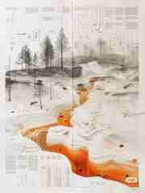

# 地理图形信息图形（Geographical / Spatial Graphic Infographics）

## 归档说明
- **分类依据**：本案例的主要数据组织逻辑为地理图形型/空间关系型。这里的“地理图形”不要求使用真实地图，重点是以空间位置、区域、路径、方向和拓扑关系组织信息。
- **表现形式**：抽象空间网络图与技术信息图的混合表达。
- **案例名称**：抽象空间网络与多层数据关系图（用户提供图片）。
- **图片文件**：原图为 816 × 1456 PNG。图片二进制尚未写入仓库；待上传后建议命名为 `案例01-抽象空间网络与多层数据关系图.png`，与本说明文档同目录。图片文件存在前，不添加会失效的 Markdown 图片引用。
- **判定边界**：图片中的空间布局是抽象的，未见可确认的地理底图、经纬度、比例尺或真实坐标。故本案例归为“空间/地理图形逻辑”，但不能据此断言它表达真实地理位置。

## 图片内容概述
画面采用米白色底色，中央形成贯穿画面的纵向密集结构，叠加红、橙、蓝等色彩的节点、圆形标记、曲线、直线、网格和细密文字注释。左右分布多个说明文本、列表、条形标记和小型图表；局部出现同心圆、放射线及节点聚集区域。整体呈现技术制图、抽象空间网络和多层信息叠加的视觉特征。

## 分类判断
- **主要数据逻辑**：地理图形型/空间关系型。
- **辅助逻辑**：关系型、分类型、多维比较。
- **表现形式**：抽象空间示意与混合图表组合。
- **不应直接判定为编年型**：画面没有明确的时间轴或按时间推进的事件序列。
- **不应直接判定为真实地图**：未能从图片辨认出地理边界、坐标系统或比例尺。其空间性主要体现在画面位置、路径和节点关系。

## A. 基本的数据逻辑（Data Logic）
本案例以空间组织为主线，借助节点、路径、区域聚集和相互连接来组织信息。

1. **空间定位逻辑**：画面中央的纵向主体形成主要空间轴线，其他元素围绕其分布。
2. **节点分布逻辑**：不同颜色、大小的圆点作为视觉节点，形成疏密不同的聚集区域。
3. **路径连接逻辑**：曲线、直线和引导线连接不同节点或信息模块，表现潜在的联系与路径。
4. **区域组织逻辑**：通过图形密度、色块和网格将画面划分为多个局部区域。
5. **多层叠加逻辑**：文字、符号、路径、节点和统计小图叠加在同一空间框架中，形成多维信息结构。

可概括为：
**空间主体/框架 → 区域分布 → 节点定位 → 路径连接 → 关系解释。**

**数据边界**：图中未提供可清晰辨认的原始数据表、坐标定义、空间单位和完整图例。因此，不能把视觉位置直接解释为真实经纬度，也不能推断节点间距离、方向或连接线具有确定的定量含义。

## B. 使用了怎样的统计图形与计算方式（Statistical Graphics）
1. **网络关系图（Network Diagram）**
   - 以节点和连接线构成网络结构，适合表达对象之间的关联。
   - 可对应节点度数、连接数量、网络密度等指标；本图未明确给出这些指标的定义。

2. **气泡/散点图（Bubble / Scatter Plot）**
   - 使用不同大小和颜色的圆形标记形成数据点分布。
   - 若用于定量表达，点的位置应对应两个变量，气泡面积可编码第三变量；本图的轴与变量未能确认。

3. **放射式与同心圆图（Radial / Concentric Diagram）**
   - 局部同心圆、放射线形成中心—外围的关系表达。
   - 可用于表达中心节点、层级或周期性分区；具体语义需图例支持。

4. **条形图与比例标记（Bar / Proportion Graphics）**
   - 画面边缘出现横向条形、短线和分组标记。
   - 可用于类别数量或比例比较，但需明确单位、分母和统计口径。

5. **网格与路径图（Grid / Path Diagram）**
   - 网格提供参照框架，路径线组织空间关系。
   - 若有真实坐标，需说明坐标系和尺度；若为抽象布局，应说明位置映射规则。

**计算方法建议**：若后续取得原始数据，可根据研究目标计算节点连接度、路径长度、空间密度、区域聚集程度、类别频数和比例。当前仅能确认图形形态，不能确认作品实际使用了哪一种算法。

## C. 视觉编码（Visual Encoding）
| 视觉元素 | 图片中的表现 | 可承担的信息作用 |
|---|---|---|
| 点 | 红、蓝、绿、橙色圆点与小型标记 | 标示节点、事件或数据项 |
| 线 | 曲线、直线、引导线和网格线 | 表现路径、连接和空间参照 |
| 面 | 中央密集色块、淡色区域和局部网格 | 区分区域或数据聚集范围 |
| 体/形 | 圆环、同心圆、放射形结构 | 建立中心—外围或层次关系 |
| 符号 | 小型图标、方块、圆形标记 | 区分对象类别和注释对象 |
| 色彩 | 米白底色，蓝、橙、红为主要强调色 | 区分数据系列、节点类别和重点 |
| 文字 | 密集注释、标签、列表和小标题 | 补充对象名称、解释和统计口径 |

**视觉优化原则**
- 米白底色降低整体视觉噪声，深色文字确保可读性。
- 蓝色与橙红色形成冷暖对比，可用于区分不同类别，但需配合图例。
- 通过节点大小、密度和线条粗细建立视觉权重；只有在映射关系明确时才具有定量意义。
- 中央高密度结构形成主视觉，左右模块承担解释与补充。
- 细线、网格和标注提供技术图纸感，但应控制交叉线数量，避免遮挡主要信息。

## D. 数据/信息架构（Information Architecture）
本案例采用“中央空间主体 + 周边多模块 + 多层叠加”的复合结构。

| 版面区域 | 可见内容 | 信息作用 |
|---|---|---|
| 中央纵向区域 | 密集图形、节点、路径与色彩叠加 | 构成主要空间框架和视觉焦点 |
| 左侧区域 | 分类标签、图例、曲线与小型统计 | 辅助解释节点和类别 |
| 右侧区域 | 说明文本、列表、网格及统计标记 | 提供分类说明与补充数据 |
| 局部焦点区域 | 同心圆、放射线、较大圆形节点 | 突出局部关系或重点对象 |
| 底部区域 | 分组条形、符号和文字说明 | 补充类别与统计信息 |

建议将信息读取顺序组织为：
**整体空间框架 → 中央重点区域 → 节点与路径关系 → 周边分类注释 → 辅助统计信息。**

若作品实际表达真实地理信息，应补充空间范围、坐标/定位依据、比例尺或方向说明；若属于抽象空间图，应明确画面位置如何映射数据，避免读者误认为是真实地理坐标。

## E. 视觉叙事架构（Visual Narrative）
本案例采用空间探索式叙事，而不是时间推进式叙事。

1. **整体认知**：先通过中央纵向主体建立整体空间印象。
2. **区域识别**：观察色彩、密度和模块边界，识别不同信息区域。
3. **节点发现**：注意不同大小和颜色的节点，找到局部聚集与重点。
4. **关系探索**：沿曲线、直线和连接线理解对象之间的潜在关系。
5. **信息核对**：阅读两侧文字、列表、条形与图例，补充解释。

可概括为：
**整体空间 → 区域划分 → 节点定位 → 路径探索 → 信息解释。**

## 与相近类型的辨析
| 类型 | 与本案例的关系 | 判断 |
|---|---|---|
| 地理图形/空间关系型 | 主要数据逻辑 | 以位置、区域、路径和节点关系组织信息，但空间坐标是否真实尚不明确 |
| 混合型信息图形 | 辅助表现形式 | 组合网络、气泡、条形、文字和符号等多种图形 |
| 关系型信息图形 | 辅助逻辑 | 通过节点和连线表现关联 |
| 示意图型 | 视觉特征相近 | 具有技术示意与结构标注，但不以操作步骤为核心 |
| 编年型 | 不属于 | 缺少时间轴和事件顺序 |

## 案例登记
| 案例名称 | 来源 | 数据结构 | 图形方法 | 视觉编码 | 叙事路线 | 待验证点 |
|---|---|---|---|---|---|---|
| 抽象空间网络与多层数据关系图 | 用户提供图片 | 空间框架、节点分布、路径连接、多层区域 | 网络关系图、气泡/散点、放射同心圆、条形标记、网格路径 | 米白底、蓝橙红节点、曲线、网格、文字标注 | 整体空间→区域→节点→路径→解释 | 主题原文、真实数据、坐标含义、图例、单位、线宽/气泡大小映射 |

---

# 案例02：自然地形与河流空间结构信息图

## 归档信息与分类判断
- **案例名称**：自然地形与河流空间结构信息图
- **图片文件**：`案例02-自然地形与河流空间结构信息图.jpg`
- **主要类型**：地理图形信息图形（Geographical / Spatial Graphic Infographics）
- **辅助表现类型**：混合型信息图形、示意图型
- **主要数据逻辑**：空间分布、地形高程、路径关系与自然要素位置关系
- **判断依据**：画面主体由地形等高线、连续的橙色带状地貌/水系、树木和地表结构组成；文字、表格和小型统计图分布在画面边缘。信息组织依赖空间位置与地形关系，而非时间先后。
- **判定边界**：图片没有清晰可读的坐标、比例尺、图例和原始数据。橙色带状结构可描述为河流状/地貌路径，但不能仅凭图像确认其真实水文属性；也不能将树木、等高线或橙色区域的视觉形态直接换算为具体数值。

## 图片内容概述
画面以浅米白色为底，中央和下半部呈现连续起伏的地形。细密的等高线沿地表延展，形成高低变化与地貌层次；一条橙色带状区域从画面下部向中上部蜿蜒延伸，构成最醒目的空间路径。画面中上部有不同高度和疏密的树木，周围叠加地表纹理、细线、点位和空间标记。顶部、右侧及底部安排了多组说明文字、数据表格、网格和小型统计图，形成主体地形与辅助信息相结合的分析版式。

## A. 基本的数据逻辑（Data Logic）
本案例以地形空间为主要组织框架，将自然要素的位置、地势变化、连续路径和区域差异组合在同一空间中。

1. **空间定位逻辑**：树木、地表标记和局部图形依附于地形空间布局，强调对象在场地中的位置。
2. **高程/地势逻辑**：等高线以连续线条表现地表高低变化；线条疏密可用于辨认地形变化快慢，但具体高程间隔在图中不可读。
3. **路径连续性逻辑**：橙色带状结构构成贯穿画面的连续路径，突出空间走向及其与周边地形的关系。
4. **区域差异逻辑**：通过地表纹理、等高线密度、颜色和树木分布区分不同局部环境。
5. **自然要素分布逻辑**：树木和小型点位作为空间对象，呈现其在场地中的分布状态。

可概括为：
**场地空间框架 → 地形高程变化 → 连续路径识别 → 自然要素分布 → 周边数据解释。**

本图可归为地理图形逻辑，但不必然是传统地图。它更接近景观/场地分析式的空间信息图：重点是地形、路径和自然要素的空间关系，而不是行政地理边界或地理位置检索。

## B. 使用了怎样的统计图形与计算方式（Statistical Graphics）
从画面可辨认的图形语言包括：

1. **等高线图（Contour Map）**
   - 以等高线表达地表高程的连续变化。
   - 在具备高程数据时，等高线通常由相同高程值的点连接生成；等高线间距可反映坡度变化。
   - 本图没有清晰标注等高距和高程数值，因此只能确认其等高线视觉表达，不能复原具体高程。

2. **地形剖面/层叠地形表达（Terrain Section / Layered Terrain）**
   - 通过地表起伏、层叠线条和局部断面感表现地形结构。
   - 可辅助解释地势变化及橙色路径与地表之间的空间关系。
   - 图中没有明确的剖切线和剖面标尺，不宜认定为严格测量剖面图。

3. **空间分布图（Spatial Distribution）**
   - 树木、点位和局部符号分布在场地中，表现自然要素的位置。
   - 若有原始数据，可进一步计算单位面积树木数量、植被覆盖率或点位密度；图片本身没有给出这些指标的明确定义。

4. **路径/流向图（Path / Flow Diagram）**
   - 橙色连续带状结构突出一条蜿蜒的空间路径。
   - 若对应水系数据，可进一步表达流向、河道宽度或流量；但图中未见明确箭头、流量单位或水文图例，不能直接判断它编码了流量。

5. **辅助统计图表（Bar / Table / Grid）**
   - 画面顶部和底部可见小型条形、表格、网格及文字模块。
   - 这些模块承担补充比较和分类说明的作用；具体统计口径和变量名称需以可读原图或原始资料为准。

**适用的计算方法（方法建议，不等于确认原图已使用）**：高程差、坡度、等高线间距、路径长度、河道断面宽度、植被密度、区域面积及类别占比。所有定量比较都需要对应的原始数据、单位、空间尺度和图例支持。

## C. 视觉编码（Visual Encoding）
| 视觉元素 | 图片中的表现 | 信息作用/阅读效果 |
|---|---|---|
| 点 | 树木基部、地表小标记和局部节点 | 标记自然对象或场地中的关注位置 |
| 线 | 密集等高线、地形纹理线、引导线和网格线 | 表现高程变化、地貌走向及注释关系 |
| 面 | 橙色带状区域、浅色地表区域和不同纹理区 | 区分主要路径与周边地貌区域 |
| 体/形 | 树木立体形态、地形层叠与起伏表面 | 建立地形深度和自然环境的空间感 |
| 符号 | 树木、圆点、短线、局部图标和表格标记 | 表示自然要素、测量点或辅助类别 |
| 色彩 | 米白底色、灰褐地表、黑灰线条、橙色重点 | 以低饱和自然色建立环境氛围，以橙色突出核心路径 |
| 文字 | 顶部、两侧和底部的说明段落与数据标签 | 补充主题解释、类别和数据依据 |

**视觉优化原则**
- 以米白色作为大面积背景，保持空间图形的通透感。
- 用灰褐色和细线描绘地形，减少大面积实色对地形细节的遮挡。
- 橙色集中用于强调主体路径，建立明确的视觉焦点。
- 树木以不同高度和疏密形成前后层次，但若高度代表真实数值，应提供尺寸或图例说明。
- 等高线应保持连续、层级清楚；重要路径与背景地形线应在粗细、颜色或透明度上区分。
- 辅助文字和小图表尽量沿版面边缘组织，避免打断主体空间阅读。

## D. 数据/信息架构（Information Architecture）
本案例采用“主体地形场景 + 周边解释模块 + 底部辅助数据”的复合架构。

| 版面区域 | 可见信息 | 信息作用 |
|---|---|---|
| 顶部 | 多组文字、细线、网格和小型标记 | 提供场地背景、分析维度或基础说明 |
| 中部主体 | 树木、地表、等高线与橙色连续路径 | 呈现核心空间结构和自然环境关系 |
| 左右边缘 | 文字注释、局部符号、线性标记和小图表 | 对主体中的局部现象进行解释 |
| 下部 | 表格、条形图和分类数据模块 | 汇总辅助指标和补充比较信息 |

建议的阅读顺序为：
**整体场地 → 地形起伏 → 橙色重点路径 → 树木与自然要素分布 → 周边统计和文字解释。**

若后续取得原始项目资料，应补充场地范围、方向、比例尺、高程基准、等高距、图例、数据来源和采集时间；若是概念性景观表达，则应明确标注为示意图，避免读者将视觉形态误认为实测数据。

## E. 视觉叙事架构（Visual Narrative）
本案例采用由整体场地进入局部地形，再沿重点路径深入的空间探索式叙事。

1. **整体环境认知**：先观察树木、地表和地形的整体关系，建立场地印象。
2. **地形结构识别**：沿等高线观察地势起伏和地表层次。
3. **重点路径追踪**：顺着橙色带状区域阅读其蜿蜒走向，关注它与周围地形的关系。
4. **自然要素观察**：进一步查看树木、点位和局部地貌的空间分布。
5. **辅助数据核对**：最后阅读边缘的文字、表格和小型统计图，理解补充信息。

可概括为：
**整体场地 → 地形结构 → 重点路径 → 自然要素 → 数据解释。**

## 与相近类型的辨析
| 类型 | 与本案例的关系 | 判断 |
|---|---|---|
| 地理图形/空间关系型 | 主要数据逻辑 | 以地形位置、区域、路径和自然要素分布组织信息 |
| 混合型信息图形 | 辅助表现形式 | 将地形图形、文字、表格和小型统计图组合 |
| 示意图型 | 辅助表现形式 | 通过场景化地形表达解释空间结构，但不以步骤教学为主 |
| 编年型 | 不属于 | 没有明确的时间轴或事件先后结构 |
| 层级型 | 非主要逻辑 | 未见明确的父子层级或由上至下的分类树 |

## 案例登记
| 案例名称 | 数据结构 | 图形方法 | 视觉编码 | 叙事路线 | 待验证点 |
|---|---|---|---|---|---|
| 自然地形与河流空间结构信息图 | 空间位置、高程变化、路径连续性、自然要素分布 | 等高线、地形层叠表达、空间分布、路径图、辅助条形/表格 | 米白底、灰褐地形线、橙色重点区域、树木符号和文字注释 | 整体场地→地形→路径→自然要素→数据解释 | 橙色区域真实含义、高程数据、等高距、方向、比例尺、树木数据与辅助统计口径 |

## 相关的数据逻辑文档
[编年型](../../01-信息图形数据逻辑/01-编年型信息图形概念定义.md) · [层级型](../../01-信息图形数据逻辑/02-层级型信息图形概念定义.md) · [编目型](../../01-信息图形数据逻辑/03-编目型信息图形概念定义.md) · [字母表型](../../01-信息图形数据逻辑/04-字母表型信息图形概念定义.md) · [地理图形型](../../01-信息图形数据逻辑/05-地理图形信息图形概念定义.md)
