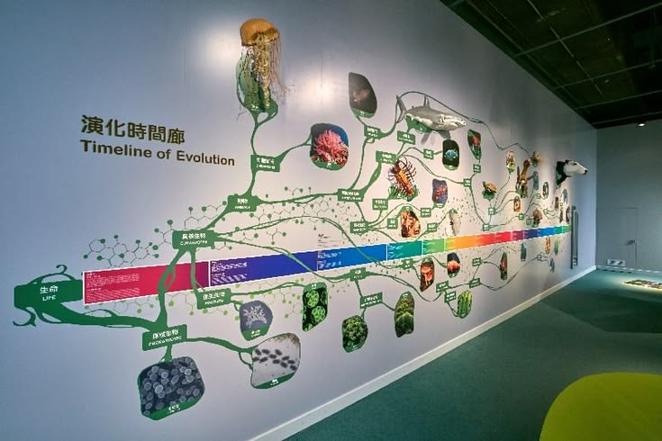
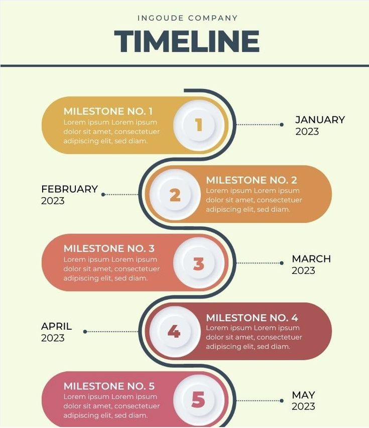
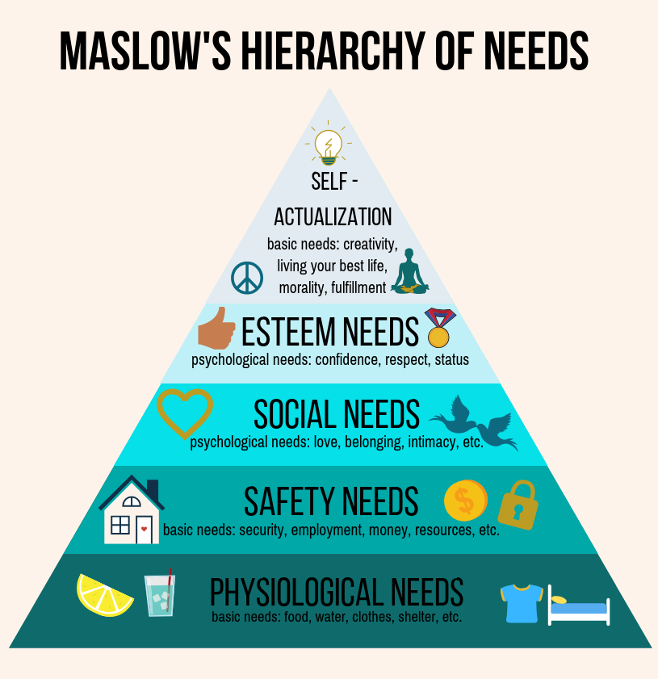
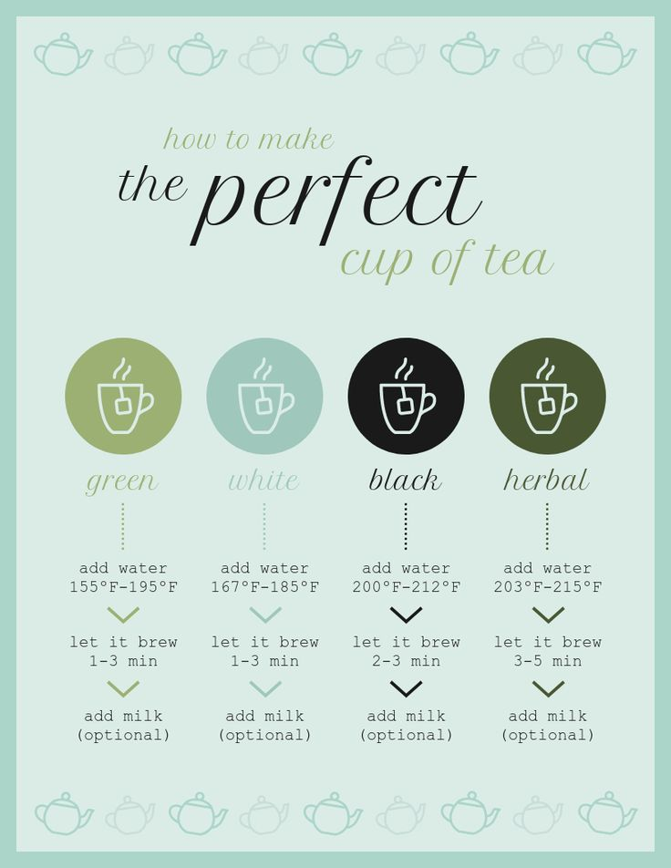
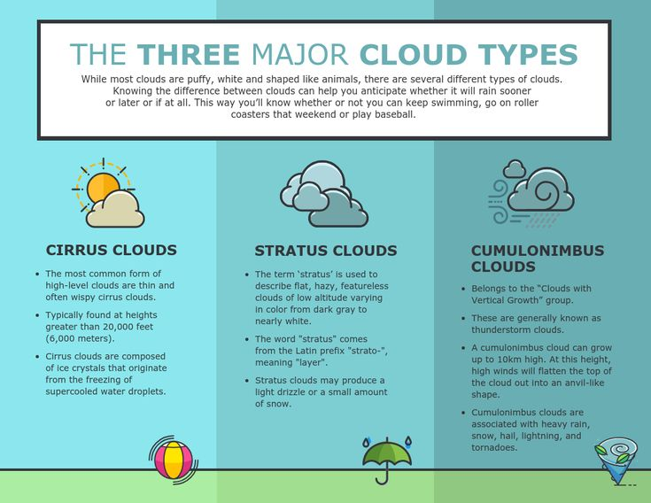
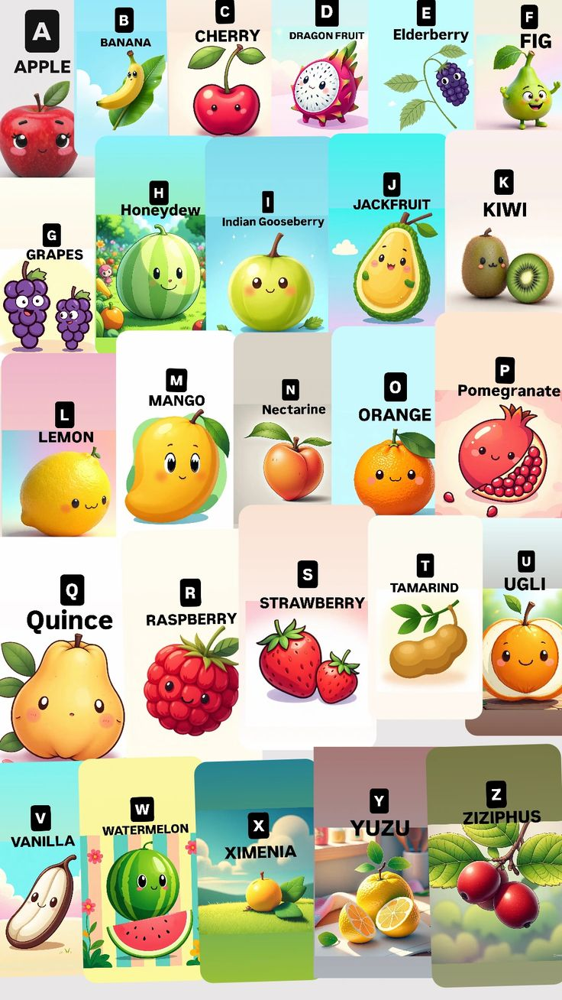
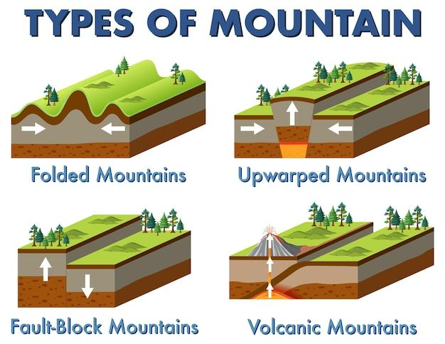

# 五种数据架构逻辑

Pinterest 信息图参考集，共 8 张。每类有简短读图说明，图片文件可在对应目录中查看。

- [2.1 编年型](#21-编年型)
- [2.2 层级型](#22-层级型)
- [2.3 编目型](#23-编目型)
- [2.4 字母表型](#24-字母表型)
- [2.5 地理图形信息图形型](#25-地理图形信息图形型)

## 2.1 编年型

按时间从早到晚排列。事件的先后由发生时间决定。

### 生命演化时间轴

沿展墙的时间带看不同阶段出现的生物。 [Pinterest 图钉](https://www.pinterest.com/pin/8444318044322607/)

### 项目里程碑时间轴

从 1 月到 5 月逐个阅读。这张是排版模板。 [Pinterest 图钉](https://www.pinterest.com/pin/986429124665796299/)

## 2.2 层级型

按层级从下到上或从上到下读。层级有顺序，每层的示例内容可以替换。

### 马斯洛需求金字塔

从底部的生理需求逐层读到顶部的自我实现。 [Pinterest 图片地址](https://i.pinimg.com/originals/67/44/9b/67449b9aca4ee4036281b4e35b3d9f59.png)

## 2.3 编目型

把同类内容归在一起，各类别并列，可从感兴趣的一类开始看。

### 四类茶的冲泡指南

绿茶、白茶、红茶和花草茶分栏呈现，方便按茶类查水温和时间。 [Pinterest 图钉](https://www.pinterest.com/pin/18718154687747172/)

### 云的类型图鉴

每列讲一种云，用相同版式列出外观和特点。 [Pinterest 图钉](https://www.pinterest.com/pin/154389093461499365/)

## 2.4 字母表型

按名称的首字母从 A 到 Z 排列，像查字典一样定位条目。

### A–Z 水果图鉴

A 是 Apple，B 是 Banana，C 是 Cherry，每个字母对应一个条目。 [Pinterest 图钉](https://www.pinterest.com/pin/913949318139514220/)

### 衬线字母 A–Z 网格

按行从 A 看到 Z，末尾另列数字。图面署名 Welkin Studio。 [Pinterest 图钉](https://www.pinterest.com/pin/612137774372103397/)

## 2.5 地理图形信息图形型

用立体剖面呈现地形和地层的空间关系。

### 四种山脉形成剖面

看岩层、断层和箭头，比较褶皱、抬升、断块和火山四种山脉的形成示意。 [Pinterest 图钉](https://www.pinterest.com/pin/17029304837938924/)

